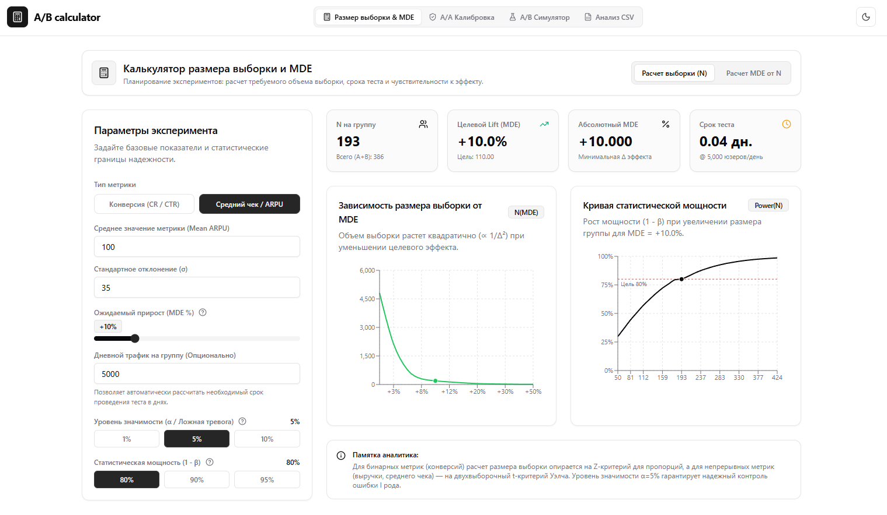
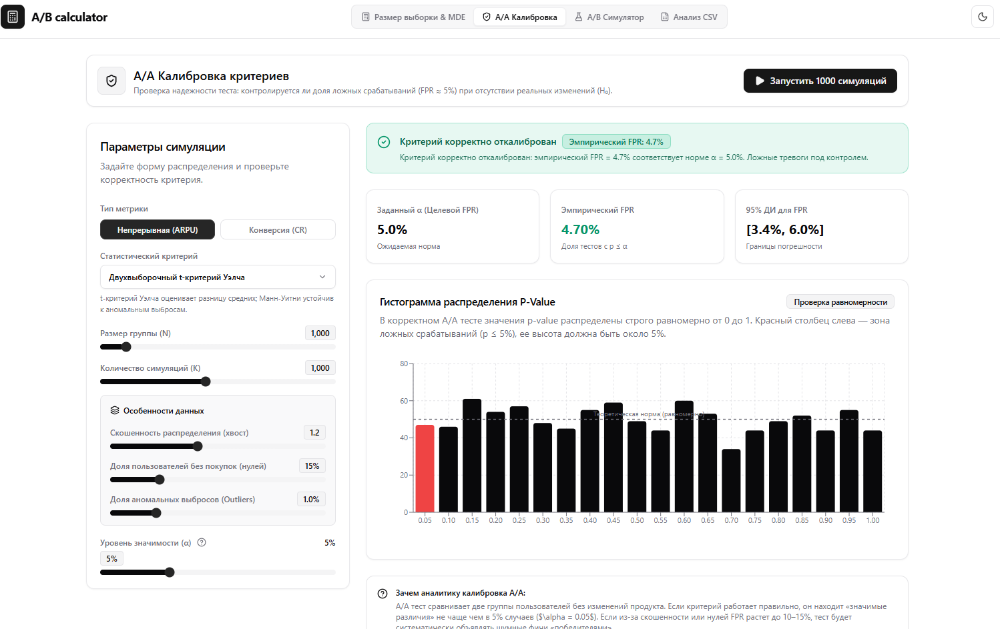
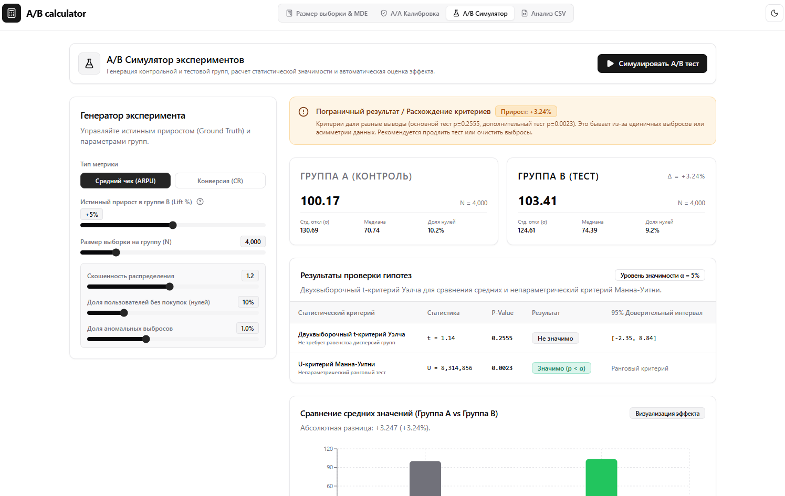
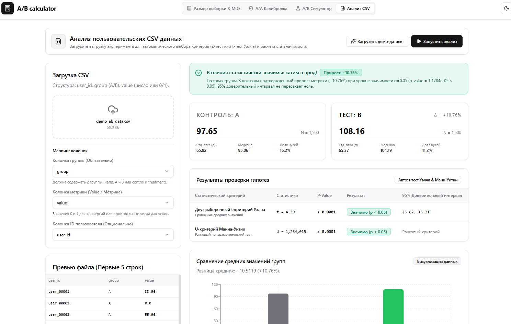

# A/B Calculator

**A/B Calculator** — интерактивная аналитическая веб-платформа для продуктовых аналитиков и исследователей, предназначенная для сквозного планирования, симуляции и анализа A/B экспериментов. Сервис объединяет классический математический аппарат с наглядной визуализацией кривых мощности, A/A-калибровкой критериев и автоматическим принятием продуктовых решений.

---

## Основные разделы платформы

### 1. Расчет размера выборки & MDE
Калькулятор для этапа дизайна экспериментов.


---

### 2. A/A Калибровка критериев
Инструмент валидации статистических критериев в условиях синтетических A/A тестов при нулевой гипотезе ($H_0$).


---

### 3. A/B Симулятор экспериментов
Интерактивная среда моделирования A/B тестов с заданным истинным приростом.


---

### 4. Анализ пользовательских CSV данных
Модуль для обработки реальных выгрузок продуктовых экспериментов.



#### 📂 Готовые демо-датасеты в корне проекта:
- [`demo_ab_data.csv`](./demo_ab_data.csv) (3 000 строк) — колонки `user_id, group, value`: базовый A/B эксперимент.
- [`demo_conversion_rate.csv`](./demo_conversion_rate.csv) (6 000 строк) — колонки `client_id, variant, converted`: тест бинарной конверсии (0/1).
- [`demo_arpu_revenue.csv`](./demo_arpu_revenue.csv) (8 000 строк) — колонки `user_id, group, revenue`: выручка с нулями и скошенным распределением.

---


### 1. Запуск бэк

```bash
cd backend
python -m venv venv
venv\Scripts\activate
pip install -r requirements.txt

uvicorn backend.app.main:app --reload --port 8000
```
API будет доступно по адресу: `http://localhost:8000`.

---

### 2. Запуск фронт

```bash
cd frontend
npm install
npm run dev
```
Фронтенд откроется по адресу: `http://localhost:5173`.

---

### 3. Запуск тестов бэка

```bash
pytest backend/tests -v
```
